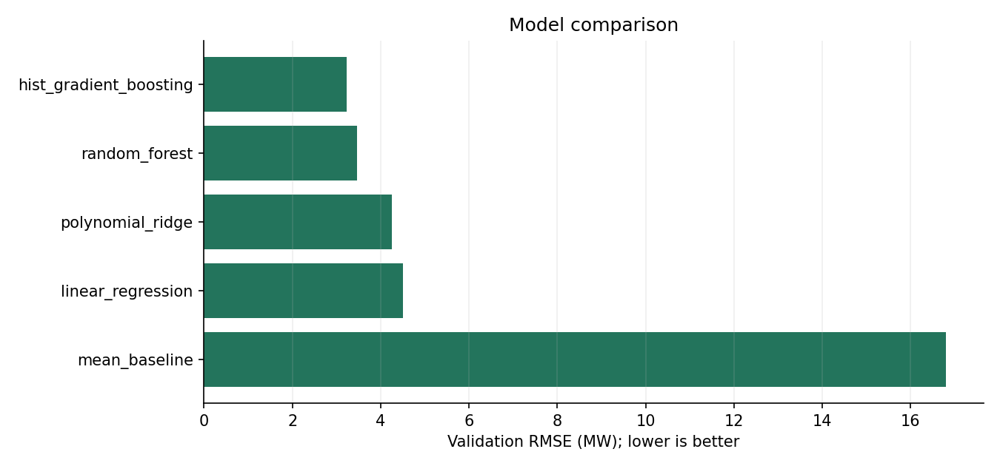
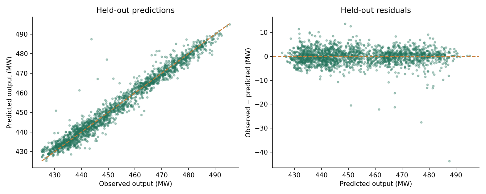
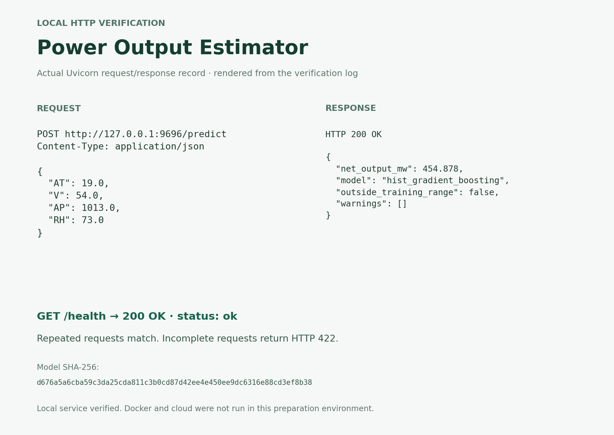

# Power Output Estimator

**Machine Learning Zoomcamp 2026 — Midterm project**

A regression model that estimates a combined-cycle power plant's electrical
output from four measurements: ambient temperature, exhaust vacuum, pressure,
and relative humidity.

The project covers data preparation, exploratory analysis, model comparison,
hyperparameter tuning, and deployment. The selected model runs behind a FastAPI
service with a browser demo and a Docker container.

## Problem

Power output varies with operating and environmental conditions. This project
explores those relationships and provides an output estimate in megawatts (MW)
for a given set of measurements.

The intended use is to help an analyst explore expected output at full load.
Each prediction refers to **the same hour** as the input measurements, so all
four inputs, including exhaust vacuum, must already be available.

## Dataset

The [Combined Cycle Power Plant dataset](https://archive.ics.uci.edu/dataset/294/combined+cycle+power+plant)
comes from the UCI Machine Learning Repository. It contains hourly average
measurements from one plant operating at full load.

| Column | Description | Unit |
| ------ | ----------- | ---- |
| AT | Ambient temperature | °C |
| V | Exhaust vacuum | cm Hg |
| AP | Ambient pressure | millibar |
| RH | Relative humidity | % |
| PE | Net electrical output — target | MW |

The original workbook contains five shuffled copies of the same data. The
project uses only `Sheet1`. Removing 41 exact duplicates from 9,568 rows leaves
**9,527 observations**. No identical feature vector crosses the data partitions.

There are no missing values. Each model pipeline still includes a median
imputer fitted within the training folds. Original measurements are retained,
including the few humidity values slightly above 100%.

The CSV is included in `data/power_plant.csv`. Source checksums and conversion
details are recorded in `data/source_manifest.json`. To download and convert
the original data again:

```bash
uv run python data.py
```

**Attribution:** Pinar Tufekci and Heysem Kaya (2014).
[DOI: 10.24432/C5002N](https://doi.org/10.24432/C5002N).
Licensed under [CC BY 4.0](https://creativecommons.org/licenses/by/4.0/).
[Original dataset archive](https://archive.ics.uci.edu/static/public/294/combined+cycle+power+plant.zip).

## Analysis and evaluation

The executed `notebook.ipynb` contains data quality checks, distributions,
feature relationships, a correlation matrix, model experiments, permutation
importance, and residual analysis. EDA uses the training partition.

The split is fixed with seed 42 after duplicate removal:

| Partition | Rows | Purpose |
| --------- | ---: | ------- |
| Train | 5,715 | Training and hyperparameter tuning with 3-fold CV |
| Validation | 1,906 | Model selection |
| Test | 1,906 | Final evaluation |

Candidates are tuned on train and compared using validation RMSE. The selected
configuration is then refitted on train + validation (7,621 rows) and evaluated
on test. The test set plays no part in model or hyperparameter selection.

### Model comparison

RMSE is measured in MW; lower is better.

| Model | Training CV RMSE | Validation RMSE |
| ----- | ---------------: | --------------: |
| Mean-output baseline | 17.079 | 16.806 |
| Linear regression | 4.576 | 4.508 |
| Degree-2 polynomial + Ridge | 4.251 | 4.245 |
| Random forest | 3.569 | 3.468 |
| **Histogram gradient boosting** | **3.357** | **3.233** |

The tuning search covers:

- **Ridge:** alpha `[0.01, 0.1, 1, 10]`.
- **Random forest:** 200 trees, depth `[12, None]`, minimum leaf size `[1, 3]`.
- **Histogram gradient boosting:** 300 iterations, learning rate `[0.05, 0.1]`,
  leaf nodes `[15, 31]`, L2 regularization `[0, 1]`, no early stopping.

**Histogram gradient boosting** achieved the lowest validation RMSE. The final
configuration uses learning rate `0.1`, 31 leaf nodes, and L2 regularization
`0.0`. Full tuning results are in `reports/metrics.json`.

| Held-out test metric | Selected model | Mean-output baseline |
| -------------------- | -------------: | -------------------: |
| RMSE, MW | **3.262** | 17.143 |
| MAE, MW | **2.269** | 14.973 |
| R² | **0.9638** | Approximately 0 |

The approximate 95% paired-bootstrap interval for test RMSE is
**2.934–3.662 MW**. This describes sampling variability in the test score,
rather than uncertainty around an individual prediction.

Temperature has the highest validation permutation importance, followed by
vacuum, pressure, and humidity. These measurements are correlated, so the
ranking should not be interpreted as causal.




## Run locally

The environment uses **Python 3.11.15** and **uv**. Dependencies are pinned in
`uv.lock`, and the trained model is included.

Run these commands from the project directory:

```bash
uv python install 3.11.15
uv sync --locked
uv run uvicorn predict:app --host 0.0.0.0 --port 9696
```

Use `uv run` outside another project's active virtual environment. It selects
this project's `.venv` automatically.

Open the [browser demo](http://localhost:9696) or
[interactive API documentation](http://localhost:9696/docs).

To retrain the model and run the tests, stop the service first:

```bash
uv run python train.py
uv run pytest -q
```

Training regenerates the model and reports. The notebook uses the same
`run_experiment()` function as the training script:

```bash
uv run jupyter lab
```

Open `notebook.ipynb`, select the project's Python kernel, and run all cells.

## API

| Endpoint | Purpose |
| -------- | ------- |
| `GET /` | Browser demo |
| `GET /health` | Service status, model name, and artifact checksum |
| `POST /predict` | Power output estimate |
| `GET /docs` | Interactive API documentation |

With the service running, open a second terminal and send the example request:

```bash
curl -s http://localhost:9696/predict -H "Content-Type: application/json" --data-binary @examples/request.json
```

On Windows CMD, `curl.exe` can be used explicitly.

Input:

```json
{"AT": 19.0, "V": 54.0, "AP": 1013.0, "RH": 73.0}
```

Response:

```json
{
  "net_output_mw": 454.878,
  "model": "hist_gradient_boosting",
  "outside_training_range": false,
  "warnings": []
}
```

Missing or unknown fields, non-finite values, and clearly invalid measurements
return HTTP 422. Accepted inputs outside the observed training ranges receive a
warning. The service checks the model checksum and scikit-learn version at startup.

The smoke test checks health, the prediction, repeatability, and rejection of
an incomplete request:

```bash
uv run python smoke_test.py
```



This image is a rendering of the recorded HTTP exchange, not a browser
screenshot. The initial records are in `reports/live_api_verification.json` and
`reports/verification_status.json`; later Docker checks are summarized below.

## Run with Docker

Start Docker Desktop or the Docker daemon. Stop any other service using port
9696, then build and run:

```bash
docker build -t power-output:midterm .
docker run --rm -p 9696:9696 power-output:midterm
```

The container loads the saved model without retraining, runs as a non-root user,
and includes a health check. Runtime dependencies come from `uv.lock`.
The service uses `PORT` when set and defaults to 9696.

In a second terminal:

```bash
uv run python smoke_test.py
docker ps
```

### Verification

Training, tests, and the Docker service were checked on Windows with Docker
Desktop on **November 15, 2026**.

| Check | Result |
| ----- | ------ |
| Training | Reproduced test RMSE **3.262 MW**, MAE **2.269 MW**, R² **0.9638** |
| Automated tests | **9 passed**, one dependency deprecation warning |
| Docker build and startup | Successful |
| Container status | **healthy**, port **9696** published |
| Health endpoint | HTTP **200**, status **ok**, matching model checksum |
| Prediction | **454.878 MW** for the example input |
| Repeatability | `deterministic_repeat: true` |
| Incomplete request | HTTP **422** |

The container reported the expected model SHA-256:

```text
d676a5a6cba59c3da25cda811c3b0cd87d42ee4e450ee9dc6316e88cd3ef8b38
```

## Optional deployment on Render

`render.yaml` provides a Docker deployment configuration. Local Docker
deployment has been tested; cloud deployment has not yet been verified.

1. Push the project to a GitHub repository with the Dockerfile at its root.
2. Create a Render Blueprint from the repository, or a Web Service using Docker.
3. Set the health check path to `/health`.
4. Review the plan before creating the service. The configuration requests
   `free`; availability depends on the account and Render's current offering.
5. After deployment, test the assigned URL:

```bash
uv run python smoke_test.py --base-url https://YOUR-SERVICE.onrender.com
```

The API supports Render's `PORT` variable. A sleeping service may take time
to start. See the [Docker deployment guide](https://render.com/docs/docker)
and [Blueprint specification](https://render.com/docs/blueprint-spec).

## Project files

| File or directory | Contents |
| ----------------- | -------- |
| `notebook.ipynb` | Executed analysis, model experiments, and conclusions |
| `data.py` | Download, checksum verification, cleaning, and splits |
| `train.py` | Tuning, model selection, evaluation, and export |
| `predict.py`, `web/demo.html` | FastAPI service and browser demo |
| `models/` | Saved pipeline and metadata |
| `reports/` | Metrics, tuning results, plots, and verification records |
| `tests/test_api.py` | Automated API tests |
| `smoke_test.py`, `examples/request.json` | HTTP checks and example request |
| `pyproject.toml`, `uv.lock`, `.python-version` | Environment and dependencies |
| `Dockerfile`, `render.yaml` | Container and optional cloud configuration |
| `START_HERE_RU.md` | Detailed Windows walkthrough |

## Limitations and next steps

The results apply to a historical dataset from one plant at full load. There
are no timestamps, so the random split cannot establish performance on future
periods. Using this model at another plant or at other load levels would
require further validation.

Some test errors exceed 20 MW despite the low overall RMSE. The service has no
per-prediction confidence intervals or live monitoring, and its business impact
has not been measured. It is an educational prototype, not a plant-control system.

Useful next steps include a temporal evaluation with dated observations,
prediction intervals, testing across load levels, and drift monitoring.

## AI assistance

AI tools helped with code and documentation. Training, automated tests, and
Docker smoke checks were run locally; the reported results come from executed code.
